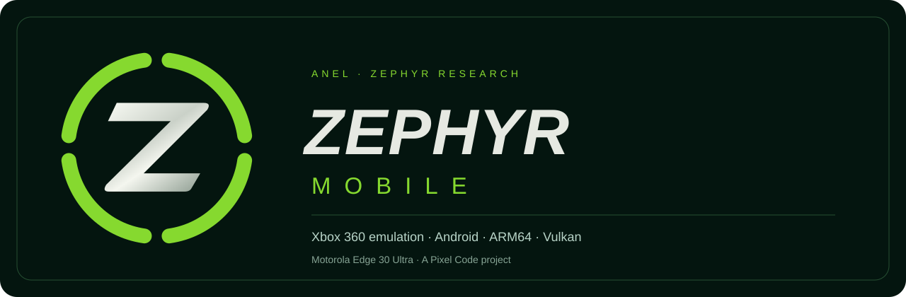

  

<strong>Xbox 360 on Android. A focused experience, built around your games.</strong> A Pixel Code project · Research edition for Motorola Edge 30 Ultra

  
  

<a href="#download-and-update">Download &amp; update</a> · <a href="#the-zephyr-experience">Experience</a> · <a href="#development-and-source">Source</a> · <a href="#credits-and-licenses">Credits</a>

## Zephyr-Mobile, by Pixel Code

**Zephyr-Mobile** is Pixel Code's experimental Xbox 360 emulator project for Android. Its visual identity combines deep green surfaces, a silver Z inside a four-segment green ring and a game library designed for both touch and controllers.

The current Research builds focus on **Motorola Edge 30 Ultra — Snapdragon 8+ Gen 1 (SM8475), Adreno 730 and 12 GB RAM**. Optimizations are evaluated per game; this target is not a promise that every title will boot or run smoothly.

## Download and update

1. Open **[Zephyr releases](https://github.com/srRodry/Zephyr-Mobile/releases)** and select the newest published Research beta.
2. Download the **`.apk` asset**. The source-code ZIP is not the Android installer.
3. Install it, open the app and select **Updates → Preview** to receive Research betas in the app.
4. Keep the same Research package and signing key when updating. Android asks you to confirm installation.

Published Research releases include the APK, its **SHA-256**, a signing report and build metadata. The app verifies download size and hash, then checks package identity, signing certificate and version before handing the update to Android.

**Research package:** `xendroid.compose.zephyr.research`. Older builds without the enabled updater need an initial manual installation. Do not uninstall the app just to update it.

## The Zephyr experience

| Area | In the project |
| --- | --- |
| **Emerald library** | Portrait and landscape layouts, circular carousel, covers, search and favorites. |
| **Touch & controllers** | Shared navigation, visible focus and configurable controls. |
| **Game management** | Per-game settings, title updates, DLC and save management. |
| **Native runtime** | ARM64 translation, Vulkan rendering and persistent shader/pipeline caches. |
| **Device-focused betas** | SM8475 compiler tuning and a reduced Vulkan worker budget. |
| **Diagnostics** | Session reports, logs and frame-time records for investigating failures. |

**Status: experimental beta.** Texture corruption, hangs and unsupported titles remain under investigation. Successful builds and automated tests do not establish game compatibility or a measured FPS gain on the phone. No performance numbers from another device are presented as Zephyr results.

## Requirements

- Android **10+**, **ARM64** and Vulkan.
- The current dedicated beta targets **Edge 30 Ultra / SM8475 / Adreno 730**; it is not a general device recommendation.
- Your own legally obtained game backups. Supported formats include ISO, ZAR, Games on Demand and supported extracted game layouts.
- Storage for your games and shader caches; no games are included in the APK.

## Testing and reporting a problem

Use the same driver, resolution, game version and scene when comparing builds. Warm the shader cache before comparing sustained performance.

For a crash, freeze or corrupted image, export **the session logs ZIP** from the app and include the game/Title ID, installed build, driver and reproduction steps. A screenshot helps locate an artifact; it cannot identify the failing CPU/GPU operation by itself.

## Development and source

- **[Research development branch](https://github.com/srRodry/Zephyr-Mobile/tree/research/optimization-round3)** — source of the current Research release series.
- **[Releases and exact source commits](https://github.com/srRodry/Zephyr-Mobile/releases)** — each release links its corresponding source.
- **[Build and validation workflow](https://github.com/srRodry/Zephyr-Mobile/actions/workflows/zephyr-performance-apk.yml)** — native checks, APK build, permanent signing and release verification.
- **[Technical build guide](https://github.com/srRodry/Zephyr-Mobile/blob/research/optimization-round3/BUILD.md)** — native toolchain and environment setup.
- **[Project structure](docs/zephyr-repository.md)** — public presentation, development and attribution boundaries.

The `main` landing page presents the project. Experimental runtime changes remain in their development branches; use the exact release commit when reproducing a build.

## Credits and licenses

Pixel Code maintains the **Zephyr-Mobile identity and this fork's development**. The emulator builds on **[Xendroid+ by phforner0](https://github.com/phforner0/Xendroid-Plus)**, the **[XenDroid Android port by rfandango](https://github.com/rfandango)** and **[Xenia](https://github.com/xenia-project/xenia)** / Xenia Canary technology.

Original authorship, source history and applicable component licenses remain in place. See **[third-party notices](THIRD-PARTY-NOTICES.md)** and the license files included with the source and APK. Rebranding does not change those licenses.

Zephyr-Mobile is an independent project, not affiliated with Microsoft. Xbox and Xbox 360 are Microsoft trademarks. No commercial games, game images, firmware or console keys are distributed here.

---

<strong>ZEPHYR-MOBILE</strong> Pixel Code · Android / ARM64 / Vulkan

