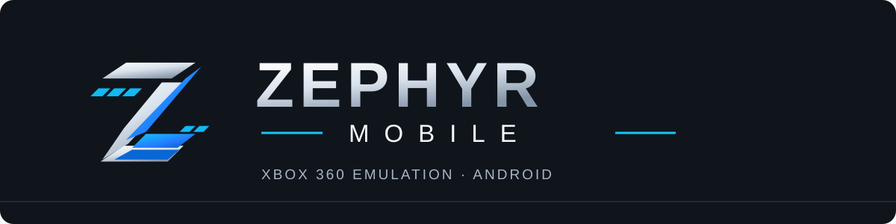

<p align="center">
  
</p>

<p align="center"><strong>Xbox 360 emulation on Android, with an interface designed for touch and controllers.</strong></p>

<p align="center">
  
  
  
  
</p>

<p align="center">
  <b>English</b> · <a href="README.pt-BR.md">Português (Brasil)</a>
</p>

<p align="center">
  <a href="https://github.com/srRodry/Zephyr-Mobile/actions/workflows/zephyr-ui-check.yml">UI checks</a> ·
  <a href="https://github.com/srRodry/Zephyr-Mobile/actions/workflows/XenDroid.yml">Android APK builds</a> ·
  <a href="https://github.com/srRodry/Zephyr-Mobile/issues">Issues and feedback</a>
</p>

---

## About the project

**Zephyr-Mobile** is an experimental Xbox 360 emulator project for Android, developed in the `srRodry/Zephyr-Mobile` repository. The goal is to make the mobile experience easier to use, with clearer navigation, a consistent interface, controller support and accessible game-library interactions.

The project **builds on existing open-source work**: [Xendroid+](https://github.com/phforner0), the earlier [XenDroid](https://github.com/rfandango) Android port, and the [Xenia](https://github.com/xenia-project/xenia) / Xenia Canary emulation core. Zephyr-Mobile is **not** a new emulator core written from scratch. Upstream technical contributions and licenses remain credited below.

> [!IMPORTANT]
> **Development build — not a stable release.** Interface changes and automation do not guarantee that a game will boot or run correctly. Compatibility depends on the game, device, Vulkan driver and emulator-core behavior. A successful UI check is not proof of a usable APK or in-game compatibility.

## What's being developed

| Area | Current work |
| --- | --- |
| **Visual identity** | Dark graphite surfaces (`#15191F`), restrained blue accent (`#237BFF`), readable typography and consistent Compose design tokens. |
| **Game library** | Search, filters, favorites, collections, cover cards and selection feedback, building on the inherited application features. |
| **Touch experience** | Layout adapted to portrait and landscape, touch-friendly interactions and game details. |
| **Controller experience** | Focus indications, selection semantics and navigation in the game library. |
| **Accessibility** | More descriptive game cards, visible focus and clearer selected states. |
| **Quality checks** | Automated Kotlin/Compose compilation and library/controller regression tests. |
| **Android packaging** | Separate ARM64 experimental APK workflow with signing and package-content verification. |

These items describe code or workflows currently under development; **they are not a claim of complete hardware validation**. Existing features inherited from upstream are documented in the source tree and linked documentation.

## Project status

| Milestone | Status |
| --- | --- |
| Zephyr-Mobile app name and basic visual identity | Implemented in the development branch |
| Touch and controller library refinements | Implemented; further real-device testing needed |
| Automated UI compilation and regression checks | Configured in GitHub Actions |
| Standalone experimental APK (`xendroid.compose.zephyr.test`) | Workflow configured; successful build and installation must be verified |
| Native Xbox 360 game compatibility on Android | Experimental; verify per title and device |
| Public stable release | **Not announced** |

The active integration branch is [`feature/zephyr-mobile-branding`](https://github.com/srRodry/Zephyr-Mobile/tree/feature/zephyr-mobile-branding). The `main` branch is kept separate while changes are validated.

### Development roadmap

1. Confirm green Android APK builds, verify the signed artifact and test installation on a real ARM64 phone.
2. Validate touch layouts, controller focus, accessibility and game-library navigation on real devices.
3. Test game startup and stability without mixing UI regressions with emulator-core issues.
4. Document verified compatibility results and prepare a reproducible experimental release process.

## Requirements

- **Android 10 or later**, running on **ARM64 (`arm64-v8a`)**.
- A **Vulkan-capable GPU** and an appropriate driver; Snapdragon/Adreno with compatible Turnip drivers is a primary target of the underlying project.
- Games from your own legally obtained Xbox 360 copies, in formats supported by the underlying emulator.

Higher-end hardware can help, but **no device or title is guaranteed to work**. Measurements published in upstream documentation are not Zephyr-Mobile performance benchmarks.

## Testing an experimental APK

1. Open [Zephyr Android APK](https://github.com/srRodry/Zephyr-Mobile/actions/workflows/XenDroid.yml).
2. Find a **successful run on `feature/zephyr-mobile-branding`**.
3. If the run produced an artifact, download the `Zephyr-Mobile_test_<commit>` APK artifact from its run page.
4. Install the signed APK on a compatible Android device and verify launch, library navigation and controller behavior before testing games.

> [!CAUTION]
> An APK may **not yet be available**. Artifacts expire, and a run without a successful build does not supply a tested installation package. Experimental builds use the Android package ID `xendroid.compose.zephyr.test`; builds signed with different temporary keys may require uninstalling the previous test build. Back up application data first.

## Building from source

The inherited native build uses **JDK 21**, Android **SDK 35**, **NDK 29.0.14206865**, **CMake 3.30.3**, Gradle **8.11.1**, Python and SPIR-V shader tools. Follow [BUILD.md](BUILD.md) for complete environment setup, native toolchain requirements and signing instructions.

For an experimental release-variant build with Zephyr's test application ID:

```bash
./gradlew -PxendroidReleaseIdSuffix=.zephyr.test -PxendroidReleaseDebuggable :app:assembleRelease
```

The Gradle task builds the application; **building alone does not mean the resulting APK is signed and installable**. The GitHub Actions APK workflow handles signing and packaging verification separately.

For the interface checks configured in CI:

```bash
./gradlew :app:compileDebugKotlin
./gradlew :app:testUitestUnitTest
```

### Source layout

| Path | Purpose |
| --- | --- |
| `app/` | Kotlin/Jetpack Compose Android app, library, navigation and user interface. |
| `emulator-core/` | Inherited native Xbox 360 emulator core and Android integration. |
| `.github/workflows/zephyr-ui-check.yml` | UI compilation and regression checks. |
| `.github/workflows/XenDroid.yml` | Experimental ARM64 APK build, signing and packaging verification. |
| `docs/ui-redesign/` | Background design explorations and interface documentation (some pre-Zephyr material). |
| `performance-tests/` | Inherited performance investigations; not Zephyr-specific validation. |

## Documentation

- [Build and installation guide](BUILD.md)
- [Game-specific configuration](GAME_COMPAT.md)
- [Interface redesign notes](docs/ui-redesign/README.md)
- [Development and feature-validation notes](docs/experiencia-em-jogo-status.md)
- [Third-party notices](THIRD-PARTY-NOTICES.md)

## Credits and licenses

Zephyr-Mobile is maintained in this repository by **[srRodry](https://github.com/srRodry)**, with substantial inherited work from:

- **Xendroid+**, created and maintained by **[phforner0](https://github.com/phforner0)**.
- **XenDroid**, the earlier Android port by **[rfandango](https://github.com/rfandango)**.
- **[Xenia](https://github.com/xenia-project/xenia)** and Xenia Canary, which provide the underlying emulator technology.
- The other open-source projects, fonts, drivers and rendering components acknowledged in [THIRD-PARTY-NOTICES.md](THIRD-PARTY-NOTICES.md).

Existing upstream licenses and notices continue to apply. In particular, the third-party notices describe licensing obligations related to the combined binary and its components. **Renaming or redesigning the application does not transfer authorship of those components.**

## Legal notice

Zephyr-Mobile is an independent, experimental software project and is **not affiliated with or endorsed by Microsoft**. Xbox and Xbox 360 are trademarks of Microsoft Corporation.

**No commercial games, game images, firmware, console keys or other copyrighted game data are distributed with this repository.** Use your own lawful backups and follow applicable law.

---

<p align="center"><sub>Zephyr-Mobile · Development branch · Interface, usability and validation first.</sub></p>
