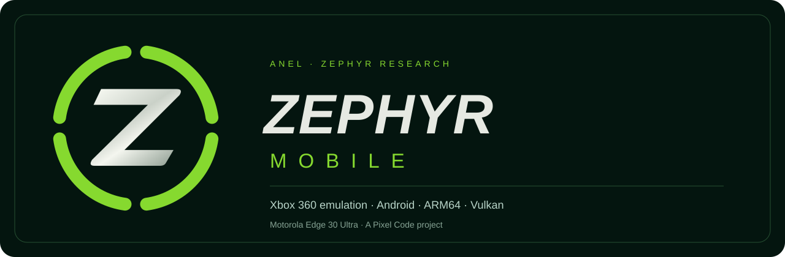

  

<strong>Emulação de Xbox 360 no Android. Leve, medida, afinada para Snapdragon.</strong> Um projeto Pixel Code · Edição Research para Motorola Edge 30 Ultra

  
  

<a href="#baixar-e-atualizar">Baixar e atualizar</a> · <a href="#a-experiência-zephyr">Experiência</a> · <a href="#desenvolvimento-e-código-fonte">Código-fonte</a> · <a href="#créditos-e-licenças">Créditos</a>

## Zephyr-Mobile, por Pixel Code

O **Zephyr-Mobile** é o projeto experimental de emulação de Xbox 360 para Android da Pixel Code. Sua identidade **Anel** combina superfícies verde-escuras, um Z prateado dentro de um anel verde com quatro segmentos e uma biblioteca pensada para toque e controle.

As versões Research atuais concentram o desenvolvimento no **Motorola Edge 30 Ultra — Snapdragon 8+ Gen 1 (SM8475), Adreno 730 e 12 GB de RAM**. As otimizações são avaliadas por jogo; esse foco não garante que todos os títulos iniciem ou rodem sem falhas.

## Baixar e atualizar

1. Abra os **[lançamentos do Zephyr](https://github.com/srRodry/Zephyr-Mobile/releases)** e selecione a beta Research publicada mais recente.
2. Baixe o arquivo **`.apk`** nos anexos. O ZIP do código-fonte não é o instalador Android.
3. Instale, abra o aplicativo e selecione **Atualizações → Prévia** para receber as betas pelo próprio app.
4. Mantenha o mesmo pacote Research e a mesma assinatura nas atualizações. O Android pede a confirmação da instalação.

Os lançamentos Research incluem APK, **SHA-256**, relatório de assinatura e identificação do build. O aplicativo confere tamanho e hash do download e verifica pacote, certificado e versão antes de abrir o instalador Android.

**Pacote Research:** `xendroid.compose.zephyr.research`. Versões antigas sem o atualizador habilitado precisam de uma primeira instalação manual. Não desinstale o aplicativo apenas para atualizá-lo.

## A experiência Zephyr

| Área | No projeto |
| --- | --- |
| **Biblioteca Emerald** | Retrato e paisagem, carrossel circular, capas, busca e favoritos. |
| **Toque e controle** | Navegação compartilhada, foco visível e controles configuráveis. |
| **Gestão de jogos** | Ajustes por título, atualizações, DLC e gerenciamento de saves. |
| **Núcleo nativo** | Tradução ARM64, renderização Vulkan e caches persistentes de shaders e pipelines. |
| **Betas para o aparelho** | Compilação ajustada ao SM8475 e orçamento menor de workers Vulkan. |
| **Diagnóstico** | Relatórios de sessão, logs e registros de tempo de quadro para investigar falhas. |

**Estado: beta experimental.** Corrupção de texturas, travamentos e títulos incompatíveis continuam sob investigação. Compilar e passar em testes automatizados não comprova compatibilidade nem ganho de FPS no telefone. Números de outro aparelho não são apresentados como resultados do Zephyr.

## Requisitos

- Android **10+**, **ARM64** e Vulkan.
- A beta dedicada atual tem como alvo o **Edge 30 Ultra / SM8475 / Adreno 730**; não é uma recomendação genérica para outros aparelhos.
- Backups próprios obtidos legalmente. Os formatos aceitos incluem ISO, ZAR, Games on Demand e estruturas de jogos extraídos compatíveis.
- Espaço para jogos e caches de shaders. Nenhum jogo acompanha o APK.

## Testes e relatos de problemas

Compare builds mantendo driver, resolução, versão do jogo e cena. Aqueça o cache de shaders antes de avaliar desempenho sustentado.

Para falha, congelamento ou imagem corrompida, exporte o **ZIP dos logs da sessão** pelo app e informe jogo/Title ID, build instalado, driver e passos para reproduzir. Uma captura ajuda a localizar o artefato; sozinha, não identifica a operação de CPU/GPU que falhou.

## Desenvolvimento e código-fonte

- **[Branch de desenvolvimento Research](https://github.com/srRodry/Zephyr-Mobile/tree/research/optimization-round3)** — fonte da série Research atual.
- **[Lançamentos e commits exatos](https://github.com/srRodry/Zephyr-Mobile/releases)** — cada versão aponta para seu código-fonte correspondente.
- **[Compilação e validação](https://github.com/srRodry/Zephyr-Mobile/actions/workflows/zephyr-performance-apk.yml)** — testes nativos, APK, assinatura permanente e verificação dos lançamentos.
- **[Guia técnico de compilação](https://github.com/srRodry/Zephyr-Mobile/blob/research/optimization-round3/BUILD.md)** — ferramentas nativas e preparação do ambiente.
- **[Organização do projeto](docs/zephyr-repository.md)** — apresentação pública, desenvolvimento e atribuição.

A página da `main` apresenta o projeto. As mudanças experimentais do núcleo permanecem nas branches de desenvolvimento; use o commit exato do lançamento para reproduzir um build.

## Créditos e licenças

A Pixel Code mantém a **identidade Zephyr-Mobile e o desenvolvimento deste fork**. O emulador utiliza o trabalho do **[Xendroid+ de phforner0](https://github.com/phforner0/Xendroid-Plus)**, do **[port Android XenDroid de rfandango](https://github.com/rfandango)** e a tecnologia **[Xenia](https://github.com/xenia-project/xenia)** / Xenia Canary.

Autoria original, histórico e licenças dos componentes são preservados. Consulte os **[avisos de terceiros](THIRD-PARTY-NOTICES.md)** e os arquivos de licença do código-fonte e do APK. A mudança de identidade visual não modifica essas licenças.

Zephyr-Mobile é um projeto independente, sem vínculo com a Microsoft. Xbox e Xbox 360 são marcas da Microsoft. Nenhum jogo comercial, imagem de jogo, firmware ou chave de console é distribuído aqui.

---

<strong>ZEPHYR-MOBILE</strong> Pixel Code · Anel · Android / ARM64 / Vulkan

